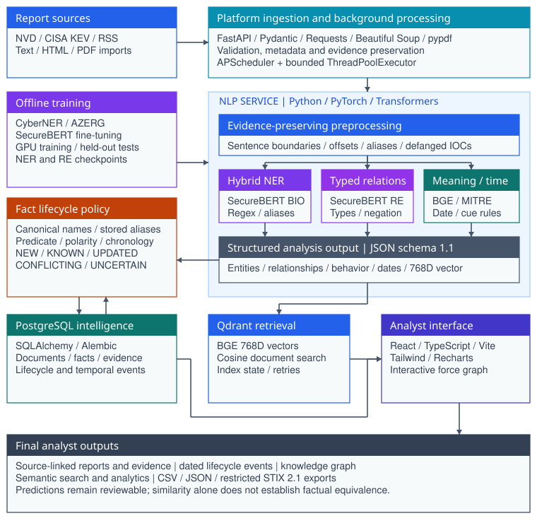

# OpenThreat NLP

### An NLP-Driven System for Semantic Correlation and Temporal Analysis of Cyber Threat Intelligence

OpenThreat turns English threat reports into intelligence an analyst can search, inspect and compare over time. It extracts entities and relationships, preserves the original evidence, identifies dated events and brings the results together in an investigation workspace.


## What you can do

| Analyst task | Implemented capability |
|---|---|
| Collect and import | NVD, CISA KEV, RSS, text, Markdown, HTML and searchable PDF |
| Identify entities | SecureBERT NER, IOC patterns and MITRE reference aliases |
| Extract relationships | SecureBERT pair classification, type constraints, triggers and negation |
| Search by meaning | BGE document embeddings indexed in Qdrant |
| Understand behavior | Explicit and semantic MITRE ATT&CK technique mapping |
| Follow changes | Temporal extraction and a persistent fact lifecycle |
| Investigate | Source-linked reports, entity timelines, analytics and knowledge graph |
| Export intelligence | CSV, JSON, classification audit and restricted STIX 2.1 |

## Run the complete application

Install and start [Docker with Compose](https://docs.docker.com/compose/install/), then clone the repository:

```sh
git clone https://github.com/Cipher-Sheild/OpenThreat.git
cd OpenThreat
```

**Windows PowerShell**

```powershell
powershell -NoProfile -ExecutionPolicy Bypass -File .\start.ps1
```

**Linux or macOS**

```sh
sh ./start.sh
```

Open **http://localhost:4000**. The scripts generate an ignored `.env` with a random database password if one does not exist, then build and start all services. Existing settings remain intact.

First startup downloads the configured NER, relation and embedding models. Wait for `ready: true` at **http://localhost:8001/health** before demonstrating extraction. A fresh database is empty; import a report or collect public sources to populate it.

See the **[complete Docker quickstart](docs/quickstart.md)** for logs, ports, first-report steps and troubleshooting.

## VS Code development and demonstration

Open the repository folder in VS Code. Start the backend and databases in the terminal:

```sh
docker compose up -d --build postgres qdrant nlp-service platform-service
```

In a second terminal, start the frontend:

```sh
cd frontend
npm ci
npm run dev
```

Open the address printed by Vite, normally **http://localhost:5173**. Vite forwards `/api` requests to the platform on port 8002. This development route needs Node.js and npm on the host; the complete Docker route above does not.

| Component | Address |
|---|---|
| Docker frontend | http://localhost:4000 |
| Frontend development server | http://localhost:5173 |
| Platform API docs | http://localhost:8002/docs |
| NLP API docs | http://localhost:8001/docs |
| NLP readiness | http://localhost:8001/health |

## Architecture



The platform validates imports and queues extraction. The separate NLP service returns entities, relations, behavior mappings, temporal events and a document vector. PostgreSQL retains facts and provenance. Qdrant indexes document vectors. The React interface displays the results and evidence.

| Layer | Technologies |
|---|---|
| Browser | React, TypeScript, Vite, Tailwind CSS, Recharts and force graph |
| Platform API | FastAPI, Pydantic, SQLAlchemy, Alembic and APScheduler |
| NLP inference | PyTorch, Transformers, Sentence Transformers and RapidFuzz |
| Models | SecureBERT fine-tuning and BGE base English v1.5 |
| Persistence | PostgreSQL 16 and Qdrant |
| Packaging | Docker Compose and Nginx |

Read [architecture](docs/architecture.md), [methodology](docs/methodology.md), [API](docs/api.md) and [database](docs/database.md) for implementation details.

## How hybrid NLP works

Trained models interpret context while deterministic patterns preserve exact identifiers and known aliases. Entity extraction combines SecureBERT with IOC patterns and MITRE reference knowledge. Relation extraction combines a trained pair classifier with typed rules and negation handling. Date extraction and fact-change policy use explicit rules.

The fact lifecycle uses **NEW, KNOWN, UPDATED, CONFLICTING and UNCERTAIN**. Semantic similarity retrieves related material; it does not by itself establish factual equivalence.

The environment template selects [OpenThreat NER](https://huggingface.co/alialtam/openthreat-ner), [OpenThreat relations](https://huggingface.co/alialtam/openthreat-re) and [BGE](https://huggingface.co/BAAI/bge-base-en-v1.5). Clearing the NER and RE model settings intentionally selects rule-only extraction. Hash embeddings are for isolated tests.

CyberNER supplies entity examples, AZERG supports relation learning, TRAM supplies technique anchors and CTI-HAL tests transfer. Training scripts, cleared notebooks, evaluators and saved metrics are included. Weights, private settings and large corpora stay outside Git. See [models and data](docs/models-and-data.md).

## Evaluation

| Saved evaluation | Result | Scope |
|---|---|---|
| Rules NER micro F1 | 0.3655 | CyberNER service evaluation |
| Fine-tuned NER micro F1 | 0.6699 | Saved windowed model evaluation |
| Hybrid NER micro F1 | 0.6207 | Integrated service evaluation |
| Relation micro / macro F1 | 0.8611 / 0.4873 | Five positive relation classes |
| Novelty accuracy / macro F1 | 0.9085 / 0.8183 | 142 constructed pairs in the NLP harness |
| ATT&CK top-1 exact | 0.7150 / 0.3162 | Held-out TRAM / CTI-HAL |

These are task-specific saved metrics, not end-to-end platform accuracy. NER gold supports differ slightly between model and service evaluations. The novelty harness includes a resolution cascade the ingestion path does not fully invoke. Rare relation classes and uncertain claims remain weak. Read [evaluation details](docs/evaluation.md).

## Screenshots

| Analytics | Knowledge graph |
|---|---|
|  |  |

The [gallery](docs/screenshots.md) also shows the report library, source evidence and exports. Counts reflect captured application state rather than accuracy estimates.

## Repository layout

```text
frontend/                       React analyst interface
services/
  nlp/
    app/                        Inference and reference resources
    training/                   Fine-tuning scripts and cleared notebooks
    evaluation/                 Evaluators and saved results
    tests/                      NLP regression tests
  platform/
    app/api/                    Imports, intelligence and exports
    app/collectors/             Public-source collectors
    app/database/               Models and Alembic migrations
    app/novelty/                Persistent fact lifecycle
    tests/                      Platform regression tests
docs/                           Setup, architecture and implementation guides
licenses/                       Required third-party notices
scripts/                        Repository checks
docker-compose.yml              Application and infrastructure stack
start.ps1 / start.sh             First-run setup and launch
```

## Development checks

In `services/nlp`, install CPU PyTorch and `requirements-dev.txt`, then run `python -m pytest -q`. These tests use explicit mock/hash modes and shared contracts. In `services/platform`, install `requirements.txt` and run `python -m unittest discover -s tests -v`; regression tests use an isolated SQLite database. In `frontend`, run `npm ci` and `npm run build`. Live smoke checks require a running NLP service.

## Operations and limitations

Collection is disabled in the example environment for a predictable first launch. Set `AUTO_INGEST=true` to schedule it. Keep API keys in `.env`. Watch model loading with `docker compose logs -f nlp-service` and processing errors with `docker compose logs --tail 100 platform-service`.

`docker compose down` preserves database volumes. Do not add `-v` unless deleting stored intelligence is intentional. The model cache persists in `services/nlp/model_cache`.

CPU throughput, cross-sentence attribution, IOC ownership, OCR, calibration and analyst correction remain development priorities. Public hosting additionally needs authentication, access controls, TLS, durable jobs and deployment-scale testing. See [deployment](docs/deployment.md).

## License

Original code and documentation use the [MIT license](LICENSE). Models, datasets, MITRE ATT&CK and TRAM retain their applicable terms. See [third-party notices](THIRD_PARTY_NOTICES.md).
