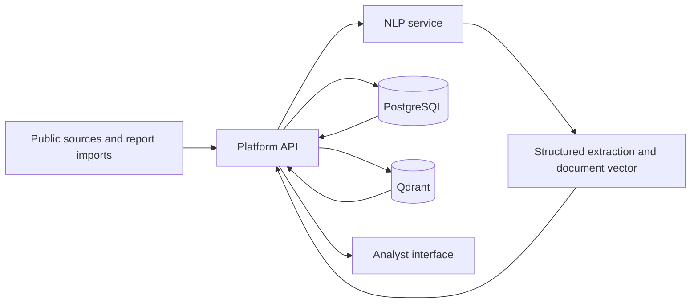
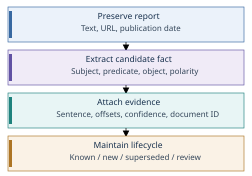

# Architecture

Reports arrive through collectors or upload and are validated by the platform API. A bounded background worker calls the separate NLP HTTP service. PostgreSQL stores extracted entities, typed relationships, polarity, lifecycle status, evidence and temporal events. Qdrant stores document vectors. The browser reads platform APIs for search, source inspection, analytics, timelines, graphs and exports.

The Mermaid source above is editable. The SVG architecture figure is also a vector asset. Offline training selects checkpoints before runtime use; collecting a report does not retrain the models.

The platform uses canonical names and stored aliases for ingestion resolution. The NLP service also offers fuzzy/semantic resolution, but that complete cascade is not integrated into every ingestion call. Document similarity does not establish factual equivalence.

## Evidence lifecycle

Facts are compared by subject, predicate, object, polarity and chronology. A repeated claim can be KNOWN; a supported later replacement can be UPDATED; incompatible claims can be CONFLICTING. Low-confidence or unresolved facts require review. Evidence and original source links remain accessible.
