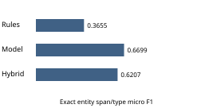
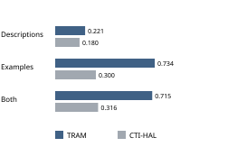
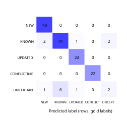

# Evaluation evidence and limits

Saved aggregate metrics are in `docs/evaluation/`. Their numeric results are preserved; personal checkpoint namespaces are replaced with a configuration placeholder. No benchmark was rerun while preparing this repository copy.

NER exact-span micro F1 is 0.3655 for rules, 0.6699 for model-only inference and 0.6207 for the integrated hybrid service. Windowed model evaluation has 5,219 gold entities; service evaluation has 5,233. The support difference prevents treating the three evaluations as perfectly identical samples. Sentence-level splitting also leaves a document-level leakage concern.

Relation positive-class micro F1 is 0.8611, macro F1 is 0.4873, and seven-class accuracy is 0.8182. DEPLOYS and EXPLOITS have zero recorded class F1; their test supports are very small. Aggregate micro F1 hides this weakness.

Recorded MITRE ATT&CK top-1 exact matching reaches 0.7150 on held-out TRAM and 0.3162 on CTI-HAL, indicating domain shift. Benchmark variants and the threshold-selection workflow require independent final-test validation before broad generalization claims.

The full NLP novelty harness records 0.9085 accuracy and 0.8183 macro F1 on 142 authored pairs. UNCERTAIN F1 is 0.2857, with recall 0.2000. Independent label review is not documented. The harness differs from live ingestion resolution, so this is not end-to-end platform accuracy.

Original engineering verification recorded 65 NLP tests and 13 platform tests, plus separate live checks of extraction, persistence, semantic search, exports and migrations. Those are historical software checks, not a multi-user deployment certification. Test-only hash embeddings and mocks are explicit isolation mechanisms.

ROC-AUC, deployment-scale throughput and public-service SLAs were not measured. Application confidence charts display model scores rather than measured precision. Runtime correctness still requires an analyst to inspect evidence and source context.
